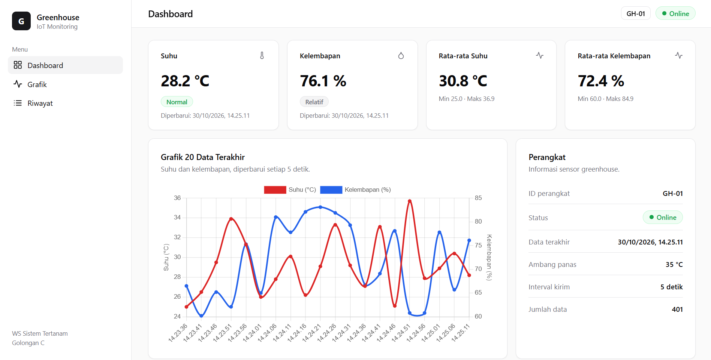
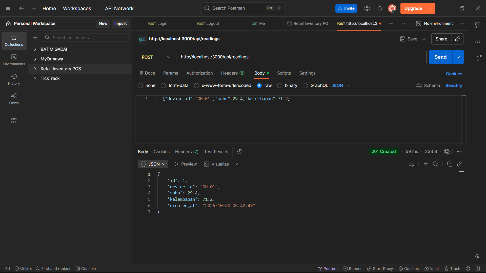

# Web Monitoring IoT Greenhouse

Tugas Praktikum WS Sistem Tertanam, Golongan C.

Aplikasi web yang menerima data suhu dan kelembapan dari perangkat (simulator), menyimpannya ke database SQLite, dan menampilkannya di dashboard yang diperbarui otomatis setiap 5 detik.

## Tim

**Yahuutt Genk**

| Peran   | Nama                   | NIM       |
| ------- | ---------------------- | --------- |
| Ketua   | Zio Vallentino Gunawan | E41241132 |
| Anggota | Faiq Raihan Albaihaqi  | E41241011 |
| Anggota | Hilmi Madani           | E41241083 |
| Anggota | Lisa Rahmawati Putri   | E41241120 |

D4 Teknik Informatika, Politeknik Negeri Jember.

## Alur Sistem

```
simulator.js  ->  POST /api/readings  ->  Express (validasi)  ->  SQLite
                                                                   |
Dashboard (polling 5 detik)  <--  GET /api/readings, /latest, /stats
```

## Teknologi

| Bagian     | Teknologi                               |
| ---------- | --------------------------------------- |
| Frontend   | HTML, CSS, JavaScript (fetch), Chart.js |
| Backend    | Node.js, Express                        |
| Database   | SQLite (better-sqlite3)                 |
| Perangkat  | Simulator (`simulator.js`)              |
| Versioning | Git, GitHub                             |

## Struktur Proyek

```
iot-monitoring/
├── public/
│   ├── index.html
│   ├── style.css
│   └── app.js
├── screenshots/
├── server.js
├── db.js
├── simulator.js
├── package.json
├── .gitignore
└── README.md
```

## Cara Menjalankan

Prasyarat: Node.js (LTS) dan npm.

```bash
git clone https://github.com/albaihaqii/iot-monitoring.git
cd iot-monitoring
npm install
```

Jalankan di dua terminal terpisah:

```bash
# Terminal 1: server
node server.js

# Terminal 2: simulator perangkat
node simulator.js
```

Buka `http://localhost:3000` di browser. File database `iot.db` dibuat otomatis saat server pertama kali dijalankan.

## Endpoint API

| Method | Endpoint                 | Fungsi                              | Respons sukses       |
| ------ | ------------------------ | ----------------------------------- | -------------------- |
| POST   | `/api/readings`          | Menerima data sensor dari perangkat | 201 + data tersimpan |
| GET    | `/api/readings/latest`   | Data terbaru                        | 200 + objek JSON     |
| GET    | `/api/readings?limit=20` | Riwayat N data terakhir             | 200 + array JSON     |
| GET    | `/api/stats`             | Rata-rata, minimum, maksimum        | 200 + objek JSON     |

Contoh payload `POST /api/readings`:

```json
{ "device_id": "GH-01", "suhu": 29.4, "kelembapan": 71.2 }
```

### Validasi

Server membalas status `400` dengan pesan error JSON jika:

- `suhu` atau `kelembapan` bukan angka,
- `suhu` di luar rentang -40 sampai 80 °C,
- `kelembapan` di luar rentang 0 sampai 100 %.

## Fitur Dashboard

- Kartu suhu dan kelembapan terkini beserta waktu pembaruan (WIB)
- Kartu suhu berubah merah dengan status "Panas" jika suhu di atas 35 °C
- Grafik garis 20 data terakhir (Chart.js)
- Tabel riwayat 10 data terakhir dan ringkasan statistik
- Pembaruan otomatis setiap 5 detik tanpa memuat ulang halaman
- Indikator perangkat: Online jika data terakhir kurang dari 30 detik, selain itu Offline

## Tampilan dan Pengujian

Dashboard:



Uji endpoint POST (status 201):


